  
  
  

## About me

- Pharmacy student at **İstinye University**, writing code on the side.
- Learning **Python** and **web development** on Codecademy, mostly so I can build my own projects.
- Daily driver: **Arch Linux + Hyprland**, with a desktop I wrote myself ([makima-hypr](https://github.com/bakiakyol/makima-hypr)). When something doesn't work on Linux, I try to write the tool myself.
- I build **personal and portfolio websites** for people. If you need one, reach out.
- Interested in the place where **healthcare meets code**.

## Tech stack

  
  
  
  
  

  
  
  
  
  
  

  
  
  
  
  

## Projects

<table>
  <tr>
    <td width="50%" valign="top">
      <h3><a href="https://github.com/bakiakyol/makima-hypr">makima-hypr</a></h3>
      
      
My Hyprland desktop, themed after Makima from Chainsaw Man. Hand-written Lua config, animations measured on my laptop, and one color palette taken from one wallpaper.

      
      
      
    </td>
    <td width="50%" valign="top">
      <h3><a href="https://github.com/bakiakyol/aula-f75-hub">aula-f75-hub</a></h3>
      
Linux configuration tool for the AULA F75 keyboard: lighting effects, per-key RGB and key remapping. GTK GUI + CLI, no vendor software needed.

      
      
      
    </td>
  </tr>
  <tr>
    <td width="50%" valign="top">
      <h3><a href="https://bakiakyol.com">bakiakyol.com</a></h3>
      
My personal website. Content is managed with a headless CMS, so I can update it without touching the code.

      
      
      
    </td>
    <td width="50%" valign="top">
      <h3><a href="https://nilu-portfolio.vercel.app">nilü's forest</a></h3>
      
A 70s record-sleeve style one-pager I built for a friend: a turntable that plays Spotify, an SVG forest that turns to night as you scroll, and three little canvas games. <a href="https://github.com/bakiakyol/nilu-portfolio">Code</a>

      
      
      
    </td>
  </tr>
</table>

## GitHub stats

  <picture>
    <source media="(prefers-color-scheme: dark)" srcset="https://raw.githubusercontent.com/bakiakyol/bakiakyol/cards/summary-dark.svg" />
    
  </picture>
  <picture>
    <source media="(prefers-color-scheme: dark)" srcset="https://raw.githubusercontent.com/bakiakyol/bakiakyol/cards/languages-dark.svg" />
    
  </picture>

  <picture>
    <source media="(prefers-color-scheme: dark)" srcset="https://raw.githubusercontent.com/bakiakyol/bakiakyol/cards/weekly-dark.svg" />
    
  </picture>
  <picture>
    <source media="(prefers-color-scheme: dark)" srcset="https://raw.githubusercontent.com/bakiakyol/bakiakyol/cards/streaks-dark.svg" />
    
  </picture>

  <picture>
    <source media="(prefers-color-scheme: dark)" srcset="https://raw.githubusercontent.com/bakiakyol/bakiakyol/output/github-snake-dark.svg" />
    <source media="(prefers-color-scheme: light)" srcset="https://raw.githubusercontent.com/bakiakyol/bakiakyol/output/github-snake.svg" />
    
  </picture>

